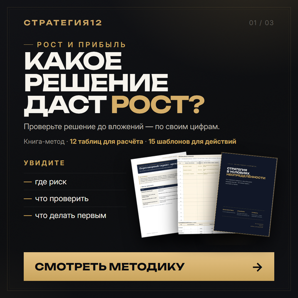
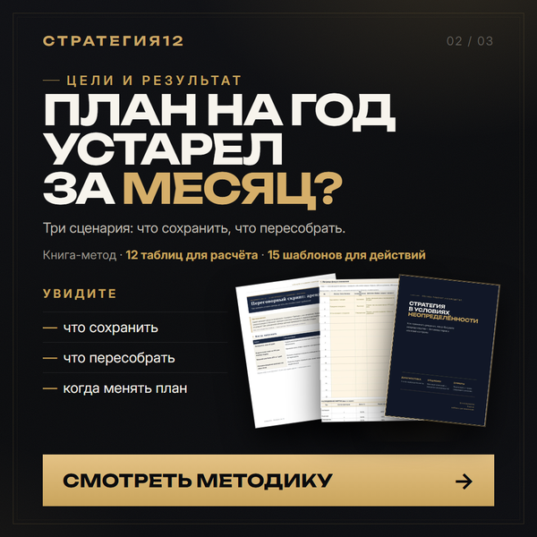
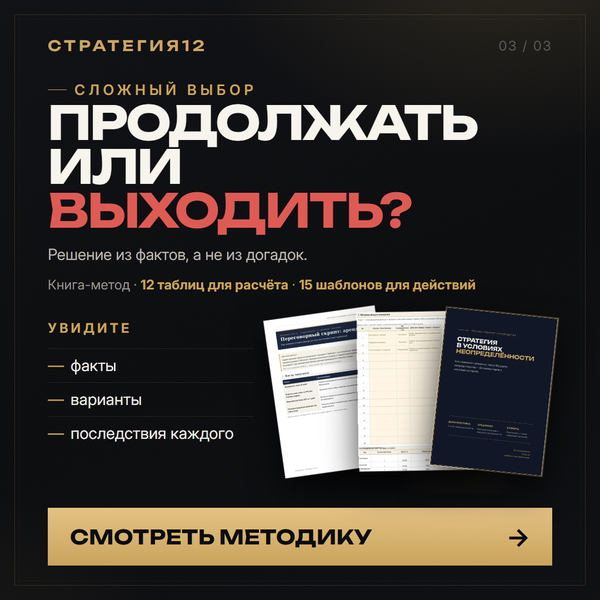

# Strategy12 — креативы и размещение в VK Ads

Кампания **42461110 «S12 Цель - Покупка»** (`site_conversions`, пакет 3229 oCPM, цель `jse:purchase`, 500 ₽/день).

Три объявления с текстами и креативами. План остановлен, объявления на модерации.

## Объявления

| РО | ID объявления | Заголовок | Креатив |
|---|---|---|---|
| Рост и прибыль | 253478773 | Рост и прибыль | [600](creatives/600/ro_rost_600.png) · [1080](creatives/1080/ro_rost_1080.png) · [1080×607](creatives/1080x607/ro_rost_wide.png) |
| Цели и результат | 253478774 | Цели и результат | [600](creatives/600/ro_celi_600.png) · [1080](creatives/1080/ro_celi_1080.png) · [1080×607](creatives/1080x607/ro_celi_wide.png) |
| Сложный выбор | 253478775 | Сложный выбор | [600](creatives/600/ro_vybor_600.png) · [1080](creatives/1080/ro_vybor_1080.png) · [1080×607](creatives/1080x607/ro_vybor_wide.png) |

## Тексты

### РО1 · Рост и прибыль

- Заголовок (40): `Рост и прибыль`
- Доп. заголовок (30): `6 шагов, 12 таблиц`
- Короткое описание (90): `Неясно, какие решения дадут рост? Оцените варианты и выберите обоснованный путь.`
- Длинное описание (220): `Рост и прибыль зависят от решений. Strategy12 помогает оценить ситуацию, проверить предположения и сравнить варианты. В комплекте — книга, 12 Excel-инструментов и 15 практических материалов.`
- Ссылка: `https://strategy12.ru/?utm_source=vk&utm_medium=cpc&utm_campaign=s12_purchase&utm_content=rost`

### РО2 · Цели и результат

- Заголовок (40): `Цели и результат`
- Доп. заголовок (30): `3 сценария, 6 шагов`
- Короткое описание (90): `Условия меняются, а цели остаются? Оцените ситуацию и определите, как двигаться дальше.`
- Длинное описание (220): `Условия меняются быстрее бизнес-планов. Strategy12 помогает оценить ситуацию, рассмотреть сценарии и выбрать действия с пониманием последствий. В комплекте — книга, 12 Excel-инструментов и 15 практических материалов.`
- Ссылка: `https://strategy12.ru/?utm_source=vk&utm_medium=cpc&utm_campaign=s12_purchase&utm_content=celi`

### РО3 · Сложный выбор

- Заголовок (40): `Сложный выбор`
- Доп. заголовок (30): `4 варианта, 6 шагов`
- Короткое описание (90): `Привычный план больше не работает? Разберите ситуацию, оцените варианты и найдите решение.`
- Длинное описание (220): `Продолжать курс, менять подход, запускать новое или выходить? Методика помогает отделить факты от предположений, оценить варианты и их последствия. В книге и 15 практических материалах — инструменты для реальных задач.`
- Ссылка: `https://strategy12.ru/?utm_source=vk&utm_medium=cpc&utm_campaign=s12_purchase&utm_content=vybor`

## Креативы

Квадрат 600×600 — для ленты VK. Широкий 1080×607 обязателен для пакета 3229: без него VK не принимает объявление. Исходники 1080×1080 — в папке `creatives/1080`.

| РО1 | РО2 | РО3 |
|---|---|---|
|  |  |  |

## Структура кампании

| Объект | ID | Статус |
|---|---|---|
| Кампания «S12 Цель - Покупка» | 42461110 | blocked (остановлена) |
| Группа «S12 · три РО» | 169133782 | active |
| РО1 · Рост и прибыль | 253478773 | active / pending |
| РО2 · Цели и результат | 253478774 | active / pending |
| РО3 · Сложный выбор | 253478775 | active / pending |

Таргетинг: гео 188, возраст 0–75, площадки и расписание — из исходного черновика.

## Отчёт о размещении

- [report/2026-11-21_rk_42461110_filled.md](report/2026-11-21_rk_42461110_filled.md) — что заполнено, ID, тексты, что заменено.

## Что дальше

1. Запустить кампанию в кабинете.
2. Дождаться модерации объявлений.
3. Проверить, что цель `jse:purchase` фиксируется пикселем 680197.
